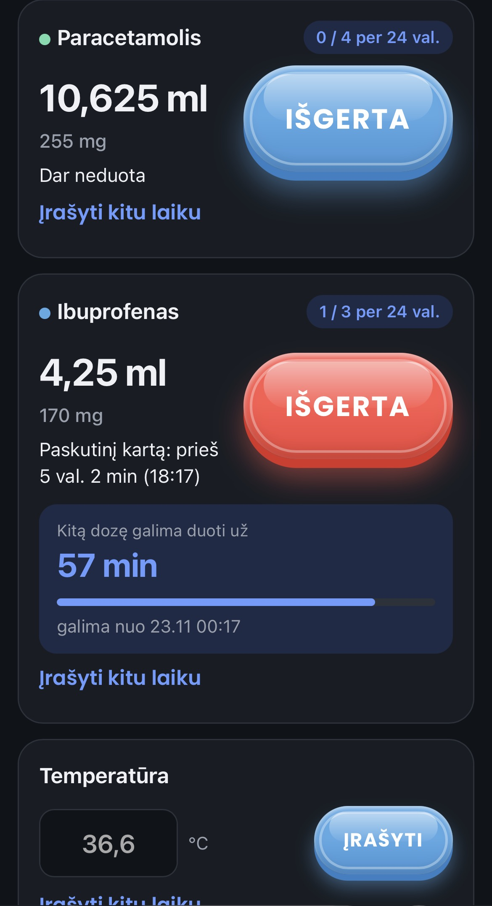

# Aš sergu

Paprasta, šviesi programėlė tėvams: ji apskaičiuoja vaikui skirtą vaisto dozę pagal svorį, rodo, kada vaistas buvo duotas paskutinį kartą ir kada jau galima duoti kitą dozę, bei leidžia sekti temperatūrą.

Veikia „iPhone“ ir „Android“ telefonuose kaip įprasta programėlė. Nereikia paskyros, diegimo iš „App Store“ ar „Google Play“. Visi duomenys saugomi tik jūsų telefone.

> **Svarbu.** Programėlė yra skaičiuoklė ir žurnalas, o ne medicininė priemonė. Ji nepakeičia gydytojo, vaistininko ar vaisto lapelio nurodymų. Prieš duodami vaistą patikrinkite dozę, stiprumą ir intervalus pagal lapelį ar gydytojo rekomendacijas.

## Programėlės vaizdas

<p align="center">
  
</p>

## Galimybės

- Keli vaikai su vardu ir svoriu, tarp jų galima greitai persijungti.
- Kiekvienam vaistui apskaičiuojama dozė (ml ir mg) pagal svorį.
- Didelis kapsulės formos mygtukas „IŠGERTA“, kuris pats keičia spalvą: **raudonas**, kol dar negalima duoti kitos dozės, ir **mėlynas**, kai jau galima.
- Mygtukas „Išgerta“ išsaugo laiką, o kortelėje matyti, kiek laiko praėjo nuo paskutinės dozės.
- Likęs laikas iki kitos galimos dozės su eigos juosta.
- Kiek dozių duota per paskutines 24 val. (slenkančios 24 val.).
- Įspėjimas, jei vaistas duodamas per anksti arba viršijama paros riba.
- Įrašų pridėjimas kitu laiku, laiko keitimas ir įrašų trynimas.
- Temperatūros grafikas (24 val., 3 d., 7 d.) su pažymėtais vaistų išgėrimo momentais.
- Duomenų atsarginė kopija ir atkūrimas.

## Kaip naudotis

### 1. Pridėkite vaiką
Pirmą kartą atidarę paspauskite **Pridėti vaiką**, įveskite vardą ir svorį kilogramais. Daugiau vaikų pridedama viršuje mygtuku **+ Vaikas**. Svorį ar vardą pakeisite paspaudę **keisti** šalia vaiko vardo.

### 2. Peržiūrėkite vaistų nustatymus (⚙︎)
Viršuje dešinėje paspauskite krumpliaračio ženklą. Kiekvienam vaistui galima nustatyti:

| Laukas | Reikšmė |
| --- | --- |
| Pavadinimas | Kaip vaistas bus rodomas programėlėje |
| Stiprumas, mg … per ml | Pvz., 200 mg per 5 ml |
| Dozė, mg/kg | Pradinės reikšmės: paracetamolis 15, ibuprofenas 10 |
| Min. intervalas, val. | Per kiek laiko galima duoti kitą dozę |
| Maks. dozių per 24 val. | Didžiausias dozių skaičius per parą |

Minimalus intervalas ir paros riba pradžioje **tušti**. Įveskite juos pagal vaisto lapelį ar gydytojo nurodymus. Kol jie neįvesti, programėlė nežino, kada galima duoti kitą dozę: mygtukas lieka mėlynas, o likusio laiko ir įspėjimų nerodo.

Stiprumą visada patikrinkite pagal savo vaisto buteliuką, nes skirtingų gamintojų sirupų koncentracija skiriasi.

Čia galima pridėti ir daugiau vaistų arba pašalinti nereikalingus.

### 3. Dozės skaičiavimas
Dozė apskaičiuojama taip:

```
mg  = svoris (kg) × mg/kg
ml  = mg ÷ stiprumas (mg) × tūris (ml)
```

Pavyzdys: 17 kg vaikui, paracetamolis 15 mg/kg, stiprumas 200 mg per 5 ml → 255 mg = 6,375 ml.

### 4. Vaisto išgėrimas ir mygtuko spalvos
Kiekvieno vaisto kortelėje yra didelis kapsulės formos mygtukas **IŠGERTA**. Jo spalva rodo, ar jau galima duoti kitą dozę:

| Spalva | Ką reiškia |
| --- | --- |
| **Mėlynas** | Kitą dozę jau galima duoti, vaistas dar nebuvo duotas arba nenustatytas nei intervalas, nei paros riba |
| **Raudonas** | Dar nepraėjo minimalus intervalas arba pasiekta paros dozių riba |

Spalva pasikeičia automatiškai, kai praeina nustatytas laikas, todėl nieko spausti nereikia. Programėlė ją atnaujina maždaug kas 10 sekundžių.

Kaip veikia mygtukai:
- **Išgerta** įrašo dabartinį laiką.
- **Įrašyti kitu laiku** (nuoroda po mygtuku) leidžia įrašyti praeityje duotą dozę, pvz., prieš 40 min.
- Raudoną mygtuką paspausti galima, bet programėlė paprašys patvirtinimo, nes dozė duodama per anksti arba viršijama paros riba.
- Kortelėje matote paskutinės dozės laiką, likusį laiką iki kitos galimos dozės ir dozių skaičių per 24 val.

### 5. Temperatūra
Įveskite temperatūrą ir paspauskite **ĮRAŠYTI**. Jei matavote anksčiau, pasirinkite **Įrašyti kitu laiku**. Grafike spalvoti taškai apačioje rodo, kada buvo duoti vaistai. Punktyrinė linija žymi 38 °C.

### 6. Istorija ir taisymas
Apačioje matomi visi įrašai. Paspaudę įrašą galite pakeisti jo laiką (ar temperatūrą) arba jį ištrinti.

### 7. Atsarginė kopija
Nustatymuose (⚙︎) yra mygtukai **Atsisiųsti kopiją** ir **Įkelti kopiją**. Naudokite juos prieš keisdami telefoną, valydami naršyklės duomenis ar norėdami perduoti duomenis kitam telefonui (pvz., žmonai ar vyrui). Kopijos failą galima išsiųsti žinute ar el. paštu. Įkėlus kopiją, dabartiniai duomenys pakeičiami.

## Įdiegimas telefone

**„iPhone“ (būtinai „Safari“ naršyklėje)**
1. Paspauskite **Bendrinti** (kvadratas su rodykle).
2. Slinkite sąrašu žemyn ir pasirinkite **Pridėti prie pradžios ekrano**.
3. Paspauskite **Pridėti**.

**„Android“ („Chrome“)**
1. Paspauskite trijų taškų meniu (⋮).
2. Pasirinkite **Įdiegti programėlę** (arba **Pridėti prie pagrindinio ekrano**).
3. Patvirtinkite.

Kiekvieno telefono duomenys yra atskiri. Programėlė veikia ir be interneto, kai ji jau buvo atidaryta bent kartą.

## Privatumas

- Programėlė neturi serverio, paskyrų ir sekimo. Duomenys niekur nesiunčiami.
- Vaikų vardai, svoriai ir įrašai saugomi tik jūsų telefone, naršyklės vietinėje saugykloje.
- Išvalius naršyklės duomenis arba pašalinus programėlę, įrašai dingsta, todėl reguliariai darykite atsarginę kopiją.

## Atsakomybės apribojimas

Programėlė pateikiama „tokia, kokia yra“, be jokių garantijų. Dozių skaičiavimas pagrįstas jūsų įvestais duomenimis (svoriu, stiprumu ir mg/kg reikšmėmis). Už įvestų reikšmių teisingumą ir vaisto davimą atsakote jūs. Abejodami kreipkitės į gydytoją ar vaistininką. Skubiu atveju skambinkite 112.
